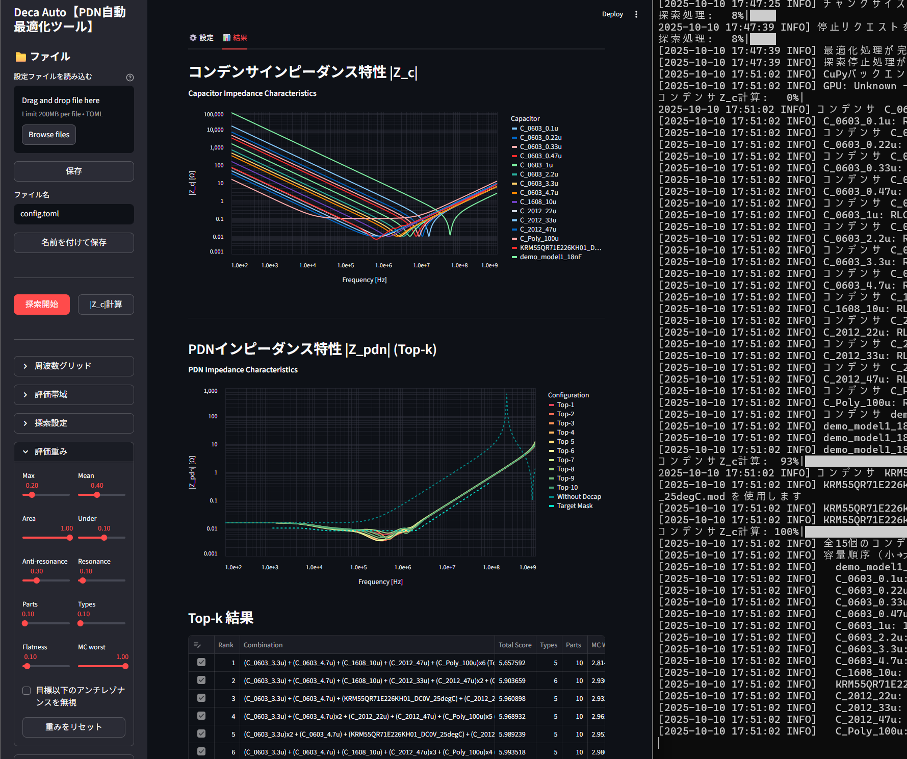
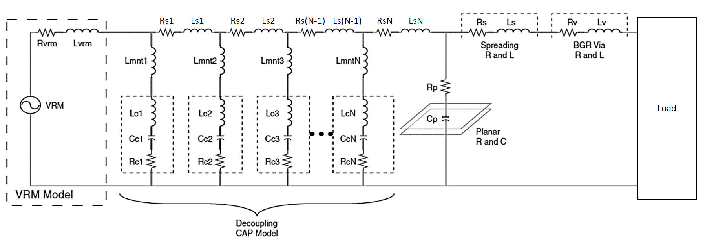
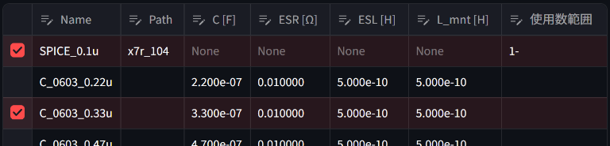
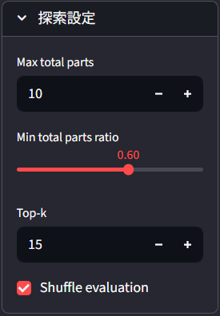
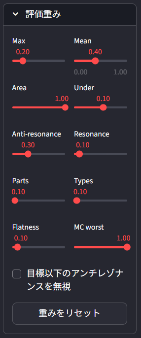
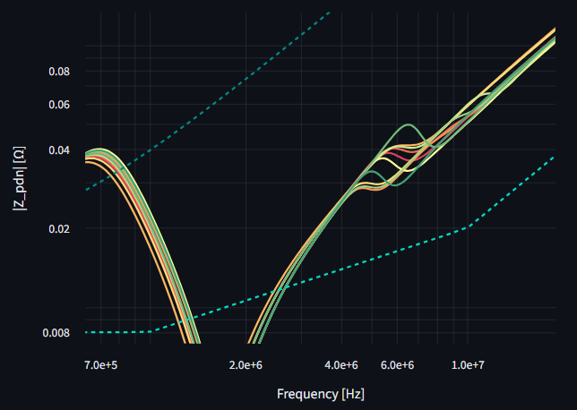

## デカ・オート (Deca-Auto)

**Deca-Auto: Automated Optimization of Decoupling Capacitor Combinations in PDN**

`デカップリングコンデンサ`の組み合わせ最適解を自動探索するツールです。  
定義されたコンデンサの中から、反共振の少ない優れた合成インピーダンスを持つ組み合わせを自動で探索します。  
旧CLI版(https://github.com/YAEemf/deca_auto.git) より大幅に機能/探索速度/評価精度が向上しています。  
**NVIDIA GPU無しでも動くようにしました！--force-numpyを指定してください。**


---

## 概要
- MurataやTDK提供の主要な2端子`SPICE`モデルを利用可能（.modファイル）
- コンデンサの基本パラメータ（C / ESR / ESL）を自分で定義して利用可能
- 実装したPDN（組み合わせにおけるコンデンサは常にLoad側から容量が小さい順に並ぶ）
  - Load側から Z_v → Z_s → Y_p(並列) → (Z_sN, Y_cm) × コンデンサの個数 → VRM の順に並ぶラダー回路です。コンデンサは1個ごとに spreading（R_sN, L_sN）とマウントインダクタンス（L_mnt）を持つ1段を占めます。
  - そのため、コンデンサを1個増やすごとにVRMから見た経路に R_sN + jωL_sN が1段ずつ直列に加わります。



## 動作環境
Python 3.12+  
(GPUを使う場合は) NVIDIA RTX 20シリーズ以降のGPUと、バージョン580以降のドライバ

## 使い方
### 1. 実行方法
#### インストール

Windows：`install.bat` を実行

Linux：
```bash
bash install.sh
```
CuPy（`cupy-cuda13x`）とCUDAランタイムも一緒にインストールされます。GPU無し、または初期化に失敗するとNumPyで動作します。  

#### 通常起動
Windows：`run.bat` を実行

Linux：
```bash
bash run.sh
```
デフォルトでは http://localhost:8501 でWebアプリが立ち上がります。

#### CLI（tomlを渡さない場合はconfig.pyのデフォルト値で探索）
起動スクリプトにオプションを渡します。

Windows
```bat
.\run.bat --no-gui --config config.toml
```
Linux
```bash
bash run.sh --no-gui --config config.toml
```

**複数のtomlが渡された場合はそれぞれの条件で順番に探索を実行します。**
```bash
--config confg1.toml config2.toml ...
```
[option]
--no-search       探索を行わずZ_cのみ計算
--force-numpy     GPUを使わずCPUのみで探索
--cuda [識別番号]   使用するCUDAデバイスを指定
--verbose         詳細なログ出力
--output          サマリExcelの出力ディレクトリ

### 2. コンデンサ設定方法（全ての数値は指数表記に対応）
コンデンサリスト：


- **SPICEモデルを利用する** 
  `.mod` ファイルパス（modelディレクトリ内のモデルはファイル名のみでOK）をGUIのリストまたは `.tomlファイル` に定義。SPICEモデルを指定時は C / ESR / ESL の指定は不要です。名前を省略した場合、自動でファイル名を使います。
  
- **LCRパラメータを直接定義する**  
  各コンデンサの C / ESR / ESL のパラメータをGUIのリストまたは`.tomlファイル` に定義。ESR、ESLを省略した場合はデフォルト値（15mΩ、0.2nH）が適用されます。

`L_mnt`：実装インダクタンス（任意）

`Derating`：Monte Carlo評価で容量を縮める割合（任意、0〜1未満）。未指定の部品には `MLCC derating`（既定0.15）が適用されるため、**ポリマー/電解などDCバイアスで容量が減らない部品は0を指定してください**。MLCCは実際のDCバイアス特性に合わせて個別に指定できます。

**【コンデンサリストを編集したら必ず`コンデンサリストを更新`を押してください！】**

※各コンデンサの`使用数範囲`を個別に指定できます。

範囲入力例：  
`3`（そのコンデンサを必ず3個使う）  
`-5`（そのコンデンサを最大5個使う）  
`2-`（そのコンデンサを2個以上使う）  
`3-5`（そのコンデンサを3～5個使う）  
`未指定`（デフォルト。0～全体の上限個数）

### 3. 探索設定
  
`Max total parts`：探索する組み合わせの`最大部品数`  
`Min total parts ratio`：高速化のために`最大部品数`に対してこの比率未満の部品数の組み合わせを探索から除外します。  
`Top-k`：保持する組み合わせの上位候補数
`Shuffle evaluation`：評価する組み合わせの順番をシャッフルします

※ `Min total parts ratio` は `Max total parts` に対する比率です。`Max total parts` を大きくすると下限も上がり、必要以上の部品数が強制されます。部品数を減らしたい場合はこの比率を下げてください（0で下限なし）。

どのようなインピーダンス特性を持つ組み合わせを探索するのか「目標マスク」と「評価重み」で設定できます。  
各評価項目を個別に算出し、それぞれに対応する`重み`を乗算した数値の総和を`スコア`として扱います。Deca-Autoではより小さい`スコア`を求めて探索します。つまり、重みを増やすとその評価項目に対する影響が大きくなり、自然とその特性に対して優れた組み合わせが最終的に残ります。  
全ての評価項目は同程度のスケール（6dB ≒ 1）に正規化されているため、重みの数値をそのまま項目間の優先度として扱えます。

**重みは探索において重要なパラメーターです。それぞれの重みを調整する事で所望のインピーダンス特性を持つ組み合わせを得る事ができます。**  
  

**評価項目（評価帯域内。カスタムマスク使用時はマスクの定義帯域）**  
目標比 `|Z_pdn| / Z_target` を対数（6dB単位）で評価します。目標を6dB以上下回る部分はそれ以上評価が良くならないため、部品を過剰に使って目標を大きく下回る候補が不当に高評価されることはありません。
- `Peak`：帯域内で最も目標に近い/超えた点の目標比（目標の1/2以下で0、目標ちょうどで1）。目標を超えた側は同じdB数のマージンの4倍の重さで悪化する（仕様違反の候補が上位に残りにくい）
- `Excess`：目標を超えた量の帯域平均（全帯域で2倍超過なら1）
- `Mean`：目標比の帯域平均（目標の1/2以下で飽和、目標超過側はPeakと同じく4倍の傾き）
- `Anti-resonance`：反共振ピークの突出量（プロミネンス：左右それぞれ自分より高い点までの谷底のうち高い方からの高さ）の合計（6dBの突出で1）。VRM-バルク間のような幅の広い反共振も検出する
- `Resonance dip`：直列共振による谷の深さ（同じ定義を上下反転）の合計（6dBの谷で1）
- `Flatness`：目標比のばらつき（加重標準偏差）
- `Parts`：部品総数 / 10（`Max total parts` に依らず1個あたり一定のコスト）
- `Types`：部品の種類数 / 5
- `MC worst`：部品公差（容量/ESR/ESL、部品ごとの容量ディレーティング）を部品1個ごとに独立に与えたMonte Carloで、最悪サンプルのインピーダンス評価（上記のPeak～Flatnessの重み付き和）が公称値からどれだけ悪化したか
- `目標以下の反共振/谷を無視`（既定で有効）：目標を超えないピークと、両肩が目標を超えない谷を評価しない。無効にすると、目標を満たしているVRM-バルク間の反共振まで減衰させようとして、ESRの大きい大容量コンデンサ（電解など）を多数並べる候補が上位になりやすい。目標以下でも平坦な特性を優先したい場合は、無効にするよりも `Flatness` の重みを上げる方が効果的

**重みによる探索操作の例**  
- 目標を確実に満たしたい時：`Peak`と`Excess`を大きくする  
- 部品数や種類がなるべく少ない候補が欲しい時：`Parts`や`Types`を大きくする（目標を満たす範囲で最少の構成が残る）  
- 共振の目立つ荒い特性でもなるべく低いインピーダンス特性が欲しい時：`Mean`を上げて`Anti-resonance`と`Resonance dip`を下げる  

### 4. 結果
PDNのインピーダンス特性グラフはマウスのホイールを回すと拡大/縮小できます。ダブルクリックでズーム解除  



---

## 👤 Author
- やえ
- https://x.com/nihon_niosumai （Twitter）

## 📄 License
- MIT (お好きに役立ててください)
---
